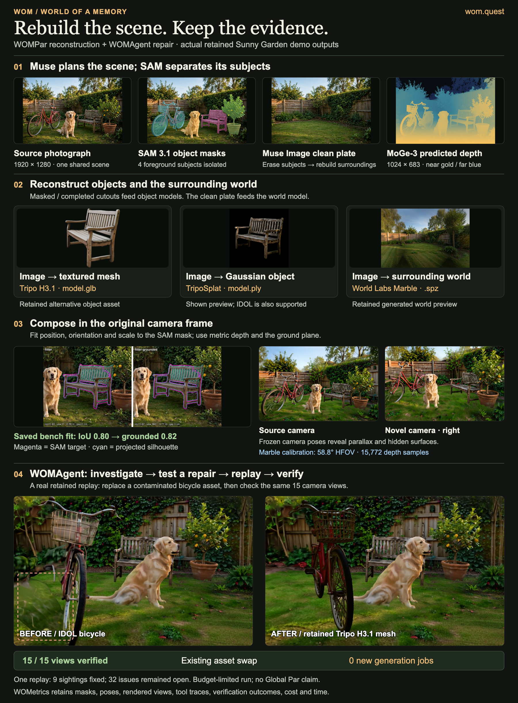
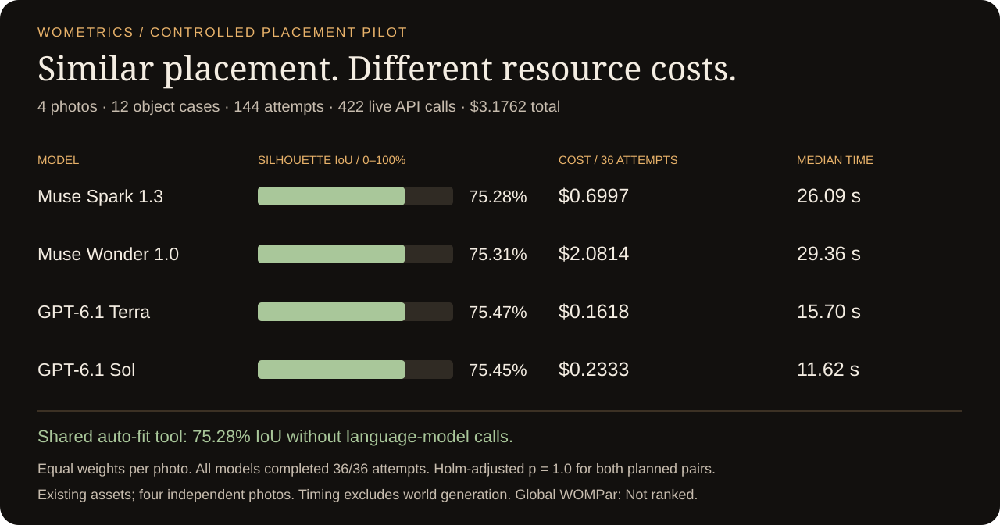
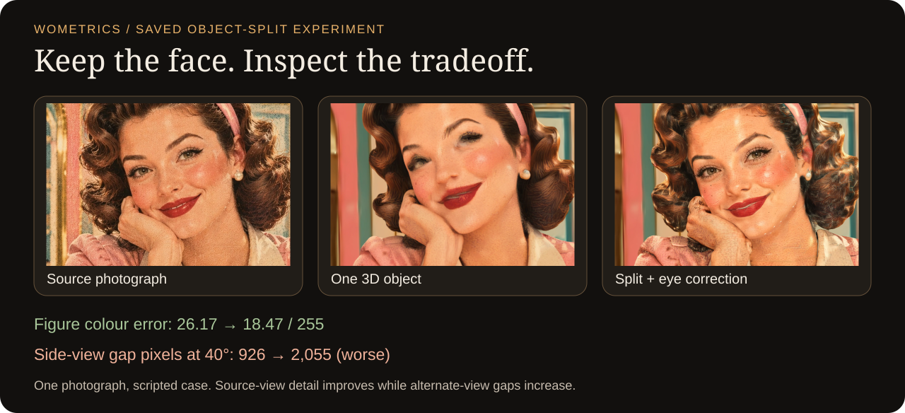

# WOM · 望 — World of a Memory

**Turn your photo into a 3D world. Measure how faithfully it remembers.**

**WOM** stands for **World of a Memory**. Its Chinese name, **望** (*wàng* in Mandarin), carries the meanings **to gaze into the distance** and **to hope or look forward to**.[^wang] For WOM, these senses connect looking back at a memory with looking beyond the photograph: turning a moment you can see into a world you can explore.

WOM reconstructs the important objects in a photograph, builds their surroundings, and composes them into a scene you can explore. **WOMPar** is our reference reconstruction system. **WOMetrics** means **World Observation Metrics**, the evaluation framework: fidelity, placement, asset quality, camera consistency, reliability, cost and time, with saved evidence behind the numbers.

**[Try WOM at wom.quest ↗](https://wom.quest)** · **[Create 3D from your photo](https://wom.quest/?create=1)** · **[Try WOMPar](https://wom.quest/wompar.html)** · **[Results & metrics](#results--metrics)** · **[Beat WOMPar](https://wom.quest/#/beat)**



[Full-resolution infographic](docs/images/wom-technical-overview.png) · [Evidence & reproducible source](docs/images/wom-technical-assets/README.md) · [Watch the recorded agent replay](https://wom.quest/u/yosun/mvxixlbz34cbfb22/agents)

The plate follows the **same source photograph** through segmentation, reconstruction and camera fitting. Its repair pair shows a separately recorded test at the **same camera pose**: WOMAgent replaced a contaminated bicycle asset, then checked all 15 saved views. These are retained demo results; the global scoring contract and model study below have separate evidence.

## Hello world: your image → 3D

### In your browser

1. **[Open the photo uploader](https://wom.quest/?create=1)** and choose a photo. JPG, PNG, WebP, AVIF, iPhone HEIC and short videos are supported.
2. Sign in, add the credits shown in the app, and choose **Create this memory**. No API keys or local setup needed.
3. Open the finished world, explore new angles, and choose **WOMetrics** to inspect its generation facts and available measurements.

**Want to explore first?** [Open WOMPar](https://wom.quest/wompar.html) for the public 3D sample, a saved comparison and the standalone download. Viewing the sample and saved report requires no account. Generation uses paid credits; the app shows packs and balance before you build.

Start with a sharp photo with clearly separated foreground objects and visible surroundings. Unseen surfaces are inferred: a plausible new viewpoint is not proof of recovered geometry.

### In your terminal: one key, one photo, one 3D file

Requires **Node 22.18+** and an [AI3D](https://ai3d.dev) account with generation credit. No npm installation, app server or database required.

```sh
git clone https://github.com/yosun/WOM.git
cd WOM

# Create .env in this folder and add: AI3D_API_KEY=your_key
# Replace the path below with your own JPG, PNG or WebP (up to 10 MiB).
node demo/wompar/wompar.mjs --provider ai3d --source "/absolute/path/to/my-photo.jpg"
```

**You get:** `world.spz` (the generated Gaussian-splat world), `report.html`, `results.json` and a resumable `job.json` under the printed run directory. Open the HTML report to download the world and follow the provider viewer link when available.

This direct Marble draft path submits **one paid generation job**, checks its current reservation against a default **$2 ceiling**, and saves recovery information before submission. The final charge can differ from the reservation. If polling times out, use `--provider ai3d --resume JOB_ID` to continue the same job.

**This is the smallest image-to-3D example.** The complete WOMPar application also plans the scene, segments and rebuilds foreground objects, estimates depth and composes the layers. Run that recipe locally with **Muse + AI3D**:

```sh
# In .env, set MUSE_API_KEY and AI3D_API_KEY; see .env.example.
npm ci
npm run dev
# Open http://localhost:5173, choose your photo, then Create this memory.
```

Local development requires no sign-in or database. [Full application guide](docs/world-of-a-memory.md) · [Standalone options & recovery](demo/wompar/README.md)

## Results & metrics

**Start with evidence you can open without credentials.** The public reports below distinguish source-view measurements, placement experiments and whole-world ranking.

| Evidence | What you can inspect | Scope |
| --- | --- | --- |
| **[Controlled model study](docs/wom-par/experiments/2026-11-04-controlled-model-study.md)** | Protocol, quality/cost/latency figures, trial data and audit; [summary JSON](docs/wom-par/experiments/2026-11-04-controlled-model-study.json) | 4 models, 12 object cases, 4 photos, 3 fresh trials per model/case |
| **[Saved WOMPar comparison](https://wom.quest/wompar/offline.html)** | Source photograph, two reconstruction renders, diagnostics and hashes; [JSON](https://wom.quest/wompar/results.json) | One public object-split case; no live API calls |
| **[Object-split experiment](demo/object-split/README.md)** | Source-view detail, side-view tradeoffs, and a self-hostable interactive 3D demo | One photograph; scripted reconstruction comparison |
| **[WOMPar 0.1 specification](docs/wom-par/0.1.md)** | Reference recipe, refinement measurements and known limitations | Frozen four-photo development pilot; reference Par 0, zero challenger ballots |
| **[Global evaluation protocol](docs/wom-par/protocols/global-v1.md)** | Camera walkthrough, evidence, blind judging, weights and completeness rules | A complete-course preference score, separate from diagnostic metrics |

### Controlled placement-agent study

[](docs/wom-par/experiments/2026-11-04-controlled-model-study.md)

| Model | Photo-weighted silhouette IoU ↑ | Completed | Total token cost ↓ | Median attempt time ↓ |
| --- | ---: | ---: | ---: | ---: |
| Muse Spark 1.3 | 75.28% | 36/36 | $0.6997 | 26.09 s |
| Muse Wonder 1.0 | 75.31% | 36/36 | $2.0814 | 29.36 s |
| GPT-6.1 Terra | 75.47% | 36/36 | $0.1618 | 15.70 s |
| GPT-6.1 Sol | 75.45% | 36/36 | $0.2333 | 11.62 s |

**What this tells us:** with the same prompts, images, tools and stopping rules, placement quality was close on this course while resource costs differed. Spark cost **4.32×** Terra; Wonder cost **8.92×** Sol. The shared auto-fit tool alone achieved **75.28%** IoU, which makes its contribution essential context for evaluating the agents.

The study completed **144 fresh attempts and 422 live API calls for $3.1762**, with zero local response-cache hits. Its primary metric averages trials within objects, objects within photographs, then photographs equally. Both planned quality comparisons had Holm-adjusted **p = 1.0**. This four-photo development sample does not establish population superiority or equivalence. Costs are model-token costs; timing excludes input preparation and world generation. **These are placement diagnostics, not Global WOMPar scores.** [Read the report and trial evidence](docs/wom-par/experiments/2026-11-04-controlled-model-study.md).

### A closer look: preserving a face

[](https://wom.quest/wompar/offline.html)

The public scripted case shows a concrete tradeoff: figure colour error improves from **26.17 to 18.47 / 255**, while side-view gaps at 40° increase from **926 to 2,055 pixels**. [Open the saved report](https://wom.quest/wompar/offline.html) · [Measurements & interactive demo guide](demo/object-split/README.md)

The related **runtime** head/body pipeline measured source-view colour error of **23.7 → 16.4 / 255** and a worst feature offset of **42.6 → 0.9 pixels** in its own one-photo run. Its nine-view side-gap total also remained worse than the one-object version (**11,916 vs. 8,674 pixels**). The scripted demo and runtime run are separate experiments. [Runtime method & limitations](docs/wom-par/0.1.md#measured-result-one-photo-beauty-counter-smile)

## Why objects + surroundings?

A single world generator can lose the identity and detail of foreground subjects. WOM rebuilds selected objects separately and combines them with the surrounding world, using the original photograph as the alignment target.

| Stage | Current implementation | Evidence retained |
| --- | --- | --- |
| Understand & separate | Muse scene planning, SAM masks, Muse Image completion | Plan, masks, cutouts and clean plate |
| Reconstruct | MoGe depth, IDOL/Tripo objects, World Labs Marble surroundings through AI3D | Depth, individual assets, generated world and job records |
| Compose & refine | Local silhouette fitting; optional Muse/Sol placement agents | Poses, overlays, tool traces and scores |
| Explore & inspect | Browser viewer and WOMetrics | Saved camera views, available measurements, failures, cost and time |
| Investigate & repair | WOMAgent navigate → inspect → repair → replay → verify | Before/after evidence; failed or interrupted trials restore the checkpoint |

The current reference uses **Marble 1.1**. WOMAgent's supported repairs operate on eligible objects/placements; they do not establish a perfect world. [Runtime & adapters](docs/wometrics/womagent.md)

## What does “Par” mean?

**WOMPar 0.1 defines the frozen reference at 0. Lower is better.** With candidate preference `p`, counting ties as half a win:

```text
Par = 100 × (1 − 2p)           −100 … 0 … +100
                              beats  reference  trails
```

For example, **−20 means 60% preference against the reference**, not 20% better geometric accuracy. A full ranking requires the same source photographs, frozen camera walkthroughs, rendering conditions and complete blind judging evidence. Human and provisional model tracks stay separate; model comparisons use both A/B orders.

The four-photo pilot anchors its exact reference at **Par 0 with zero actual ballots**. **No challenger win is established.** A missing measurement stays missing, and a partial course stays **Not ranked**. The standalone evaluator reports a separate source-view Par after both A/B comparisons; generating a 3D file alone does not produce a global score.

[Reference specification](docs/wom-par/0.1.md) · [Scoring protocol](docs/wom-par/protocols/global-v1.md) · [Contribution contract](docs/wometrics/contributing.md)

## Evaluate or improve your own method

**[Beat WOMPar](https://wom.quest/#/beat)** gives your agent a shared source image, reference scene/camera, safe WOMetrics diagnostics and a copyable reconstruction brief. Bring any model, agent, script, solver or renderable representation.

For a zero-cost first run:

```sh
node demo/wompar/wompar.mjs --offline
```

For your own source-view comparison, put one supported vision key in `.env`, then supply renders made with the same framing:

```sh
node demo/wompar/wompar.mjs --provider openai \
  --source photo.jpg --reference reference.png --candidate candidate.png
```

Muse, OpenAI, Gemini and Anthropic can each review with one key. Two paid calls swap A/B order. Select the provider explicitly when generating from a photo: auto mode prioritizes reviewing providers over AI3D. [Complete standalone guide](demo/wompar/README.md)

For a full-course submission, declare your method/revision, models, tools and rendering adapter using the [setup schema](packages/metrics/schema/agent-setup-v1.json), freeze its outputs, and retain the required comparison evidence:

```sh
npm run bench:global -- --template /tmp/my-submission.json
npm run bench:global -- --submissions /path/to/finished-submission.json
```

The global importer verifies provenance and evidence hashes; it does not generate worlds or judgments. Its frozen reference assets are private local data, so a fresh public checkout starts with the standalone case above. The reusable framework is **[@wom/metrics](packages/metrics/README.md)**.

## Documentation & development

| Guide | Use it for |
| --- | --- |
| [Standalone WOMPar](demo/wompar/README.md) | Your photo, one-key generation, offline evaluation, model selection and recovery |
| [World of a Memory](docs/world-of-a-memory.md) | Full pipeline, viewer, accounts, credits, local setup and server operation |
| [WOMetrics framework](packages/metrics/README.md) | Evaluation tasks, subjects, scoring, reports and spend accounting |
| [WOMPar 0.1](docs/wom-par/0.1.md) | Original reference, runtime amendments, frozen course and measured limitations |
| [Contribute a method](docs/wometrics/contributing.md) | Setup descriptors, rendering adapters and complete-course submissions |
| [WOMAgent](docs/wometrics/womagent.md) | Runtime, repair boundaries, replay, rollback and provider adapters |
| [PrismDeck](https://github.com/yosun/PrismDeck) | Standalone 3D pane navigation generalized from WOMDeck; [live demo](https://yosun.github.io/PrismDeck/) |

WOMDeck uses PrismDeck for browsing photographic panes. The photo deck loads the 3D viewer when a visitor enters a world.

```sh
node --test demo/wompar/wompar.test.mjs  # Standalone; no installation or keys
npm run typecheck
npm run build                          # Web app, public demo & standalone download
```

Keys stay on your computer or server. Keep `.env` private; the [environment template](.env.example) contains placeholders. Public examples are bundled explicitly; private worlds, benchmark caches and credentials are excluded from the standalone download.

[^wang]: Pronunciation and meanings: [Taiwan Ministry of Education, *Revised Mandarin Chinese Dictionary*, 望](https://dict.revised.moe.edu.tw/dictView.jsp?ID=11566).
