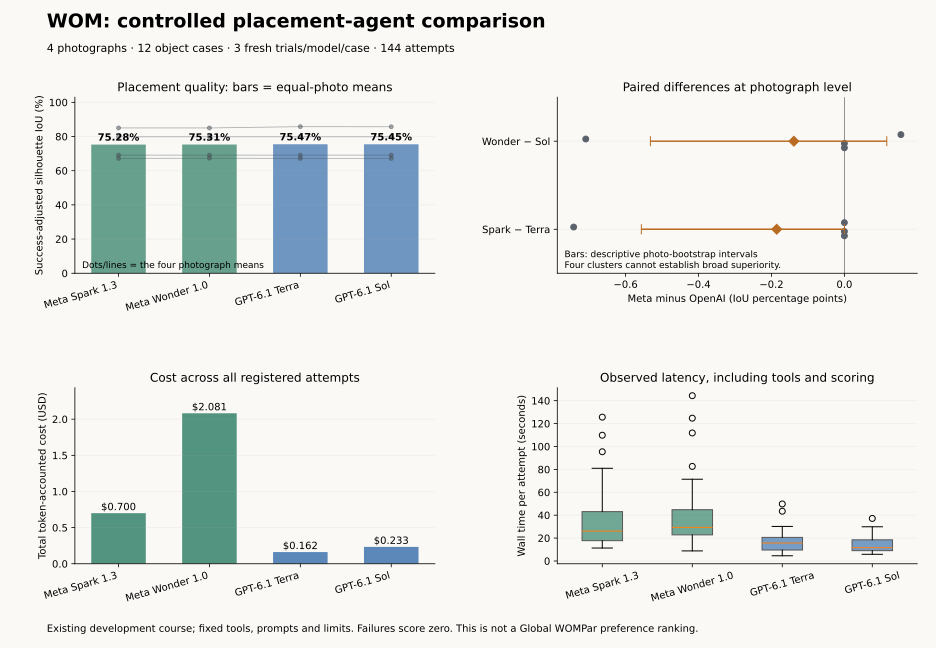

# Meta and OpenAI placement agents in WOM

## Abstract

Meta Muse Spark 1.3 and Muse Wonder 1.0 completed all placement tasks in a controlled pilot, but showed no measured quality advantage over OpenAI GPT-6.1 Terra and GPT-6.1 Sol. Across four project photographs, photo-weighted silhouette IoU was 75.28% for Spark versus 75.47% for Terra, and 75.31% for Wonder versus 75.45% for Sol. Spark cost 4.32 times Terra and Wonder cost 8.92 times Sol under the recorded workload. Median attempt times were also longer for the Meta models. Neither prespecified quality comparison was statistically significant; four independent photographs do not establish equivalence or population superiority.

## Research question

For the same saved WOM object-placement tasks, how do Meta and OpenAI models compare when they receive identical evidence, geometric tools, prompts and stopping rules?

The experiment measures a model's use of WOM's existing placement tools. It does not compare coding assistants, segmentation models, image editors, new 3D asset generation or complete-world preference. Claude Opus and Sonnet were used through Kiro to develop the original project; their development history is not a measured comparator in this experiment.

## Design and materials

Collection ran on November 4, 2026 in America/Los_Angeles, ending November 5 at 00:51:34 UTC. A [local protocol](2026-11-04-controlled-model-study/protocol.json) was frozen before the first model request. It specifies the hypotheses, inputs, trial schedule, stopping rule, failure policy and analysis. This was local protocol registration, not independent external preregistration.

- **Models:** `muse-spark-1.3`, `muse-wonder-1.0`, `gpt-6.1-terra`, and `gpt-6.1-sol` through their native APIs.
- **Sample:** 12 object/asset cases from four distinct project photographs: garden, cloister, vanity and poolside. The duplicate portrait reconstruction was excluded by source identity. Existing annotation exclusions applied only to their stated mask versions; the cloister cases used corrected version 2 masks.
- **Common evidence:** the same source image with object outline, eight-yaw asset turntable, camera and object conventions, saved IDOL asset, MoGe-3 depth, mask and geometry for each case. Input and source-code hashes are retained in the protocol.
- **Tools:** the existing WOM placement loop with `auto_fit`, `render_placement`, `measure_depth` and `submit_placement`. Every agent was instructed to start with `auto_fit`. All models could use the same guarded original-versus-polished fitter.
- **Limits:** medium reasoning effort, at most 16,000 output tokens per model call, eight non-submission tool calls and eleven model turns. Partial-placement fallback was disabled. The same effort label does not guarantee identical internal computation across providers.
- **Replication:** three fresh attempts per model and object case, for **144 agent attempts**. Case/trial blocks and model launch order were shuffled with a fixed seed. The four models ran concurrently within each block. Local response caches were bypassed; provider-side prompt caching remained enabled and its token usage was recorded.
- **Stopping:** the fixed trial count and a $20 study cap, without outcome-based early stopping. Actual token-accounted spend was **$3.1761925**, across **422 live API calls**.

The inputs were held in memory throughout collection. A subsequent byte-hash check found no changes to the 48 original input files. The experiment saved observations but did not replace the world's active scene placements.

## Outcomes and analysis

The primary outcome was **success-adjusted source-camera silhouette intersection over union**, scored numerically by WOMetrics against the common object mask. A failed final submission would score zero; missing attempts would remain unavailable. All 144 attempts returned valid final submissions, so no failure penalties were applied.

Trials were averaged within an object, objects within a photograph, and the four photographs with equal weights. Photographs, rather than objects, API calls or repeated trials, were the independent units for the paired analysis. The generic dashboard's raw trial mean is a different statistic and should not replace this primary estimate.

The two prespecified comparisons were **Spark versus Terra** and **Wonder versus Sol**. We used exact two-sided photograph-level sign-flip tests with Holm correction across the two comparisons. Exhaustive photograph-bootstrap percentile intervals are reported descriptively; only four clusters are available. Even with four nonzero effects all pointing in one direction, the smallest possible two-sided sign-flip p-value would be 0.125. This pilot therefore cannot support a conventional 0.05 significance claim or establish equivalence.

Secondary outcomes were completion, colour and depth error, absolute support gap, token-accounted cost, model/tool calls and observed latency. Latency excludes initial input preparation and world generation; deterministic fits were memoized across agents and trials. Costs exclude the previously purchased common assets and local compute. Prices use returned token usage at configured standard rates, rather than an invoice reconciliation: [Meta pricing](https://dev.meta.ai/docs/pricing-rate-limits), [GPT-6.1 Terra](https://developers.openai.com/api/docs/models/gpt-6.1-terra), [GPT-6.1 Sol](https://developers.openai.com/api/docs/models/gpt-6.1-sol).

## Results



| Model | Completed attempts | Photo-weighted IoU | Total token-accounted cost | Median attempt time |
| --- | ---: | ---: | ---: | ---: |
| Meta Muse Spark 1.3 | 36/36 | 75.2818% | $0.699697 | 26.089 s |
| Meta Muse Wonder 1.0 | 36/36 | 75.3149% | $2.081427 | 29.359 s |
| OpenAI GPT-6.1 Terra | 36/36 | 75.4674% | $0.161783 | 15.7045 s |
| OpenAI GPT-6.1 Sol | 36/36 | 75.4534% | $0.233285 | 11.6195 s |

| Prespecified pair | IoU difference, Meta minus OpenAI | Descriptive photo-bootstrap interval | Holm-adjusted p | Object wins / ties / losses for Meta |
| --- | ---: | ---: | ---: | ---: |
| Spark versus Terra | −0.1856 percentage points | −0.5568 to 0.0000 points | 1.000 | 0 / 11 / 1 |
| Wonder versus Sol | −0.1386 percentage points | −0.5319 to +0.1162 points | 1.000 | 0 / 11 / 1 |

Object wins and losses require a difference greater than 0.01 IoU after averaging the three attempts; smaller differences count as ties. These object counts are descriptive, not independent scene samples.

For Spark versus Terra, the only photograph with a nonzero mean quality difference was the vanity scene. Wonder versus Sol also differed slightly on the poolside scene. Both OpenAI models improved the brush-holder placement beyond the common fitter, while most cases retained the fitter's pose.

Spark cost **4.32×** Terra and had **1.66×** its median attempt time. Wonder cost **8.92×** Sol and had **2.53×** its median attempt time. These are observed ratios for this workload, not universal provider speed or price ratios.

The geometric reference achieved **74.9801%** photo-weighted IoU; the stronger `auto_fit` tool available to every agent achieved **75.2818%** without language-model calls. Spark's final placements matched that tool's primary score. The other models' aggregate improvements were small on this course.

## Interpretation and limits

Meta's models handled the standardized placement workflow successfully, and their measured placement quality was close to the OpenAI comparators. They provided no observed quality advantage on the primary metric and incurred higher model cost and longer median latency. The quality tests do not establish a population difference or equivalence.

This is a small convenience sample already used during project development, not a held-out benchmark. Three repeated calls estimate variability on the same inputs; they do not turn four photographs into 144 independent scenes. Every model had the same strong fitter and could optimize the source-view metric through tools. IoU against a SAM mask can reward mask errors or contaminated geometry and does not verify unseen surfaces, novel-view appearance or physical correctness. The results apply to this placement workflow and should not be generalized to Meta's entire model portfolio or overall coding ability.

No complete-world preference ballots were collected. This study therefore does not produce a Global WOMPar score or establish a whole-world winner.

## Data and reproduction

- [Machine-readable summary and secondary measurements](2026-11-04-controlled-model-study.json).
- [Frozen protocol](2026-11-04-controlled-model-study/protocol.json).
- [All 144 numerical trial records](2026-11-04-controlled-model-study/trials.json).
- [Programmatic consistency audit summary](2026-11-04-controlled-model-study/audit-summary.json).
- [Reproduce the paired numerical analysis](2026-11-04-controlled-model-study/reproduce-analysis.mjs).
- [Collection-time critical source snapshot](2026-11-04-controlled-model-study/collection-source/).
- [Collection-time collector source](2026-11-04-controlled-model-study/collection-source/scripts/study-models.ts), [analysis implementation](../../../scripts/model-study-analysis.ts), [analysis tests](../../../scripts/tests/model-study.test.ts), [audit](../../../scripts/audit-model-study.mjs), and [figure/report generator](../../../scripts/report-model-study.py).

Recompute the published numerical analysis without credentials or model calls using Node 22.18 or later:

```sh
node docs/wom-par/experiments/2026-11-04-controlled-model-study/reproduce-analysis.mjs
node --test scripts/tests/model-study.test.ts
```

The consistency audit verified matched initial prompts, image hashes and tool contracts, distinct provider response IDs, complete trial cells, independent equal-photo arithmetic, and agreement between provider usage costs and the WOMetrics ledger. This was a programmatic audit, not independent human review.

The original photos, 3D assets, full model transcripts, image receipts and 144 WOMAgent execution timelines remain in local project storage. They are not included in the public numerical release. Fresh model collection requires the saved assets, compatible WOM runtime and provider access; the public files support reanalysis of the recorded outcomes without those private inputs.

The collection-time source is retained against the protocol hashes. After collection, tool-count metadata was added for the existing dashboard exporter and a read-only report regeneration command was added. That formatting repair made no further provider calls and changed no trial outcomes.

Protocol SHA-256: `db3e40466f91b6564e14bce84af6115de18d9eda88c7c6853e991e7ccbd7dbdf`.

## Answer to the project comparison question

Compared with the OpenAI models we tested on the same placement tasks, Meta's Muse Spark 1.3 and Muse Wonder 1.0 achieved similar observed placement quality and completed every attempt, but used more model spend and had longer median latency. In a controlled WOMetrics pilot with identical WOMAgent inputs and tools, 12 object cases from four photographs and three fresh attempts per model/case, Spark achieved 75.28% photo-weighted silhouette IoU versus 75.47% for GPT-6.1 Terra, while Wonder achieved 75.31% versus 75.45% for GPT-6.1 Sol. Spark cost 4.32 times Terra and Wonder cost 8.92 times Sol; their median attempt times were 26.09 versus 15.70 seconds and 29.36 versus 11.62 seconds, respectively. Neither prespecified quality difference was statistically significant, and this four-photo development pilot does not establish equivalence or a general model ranking.
